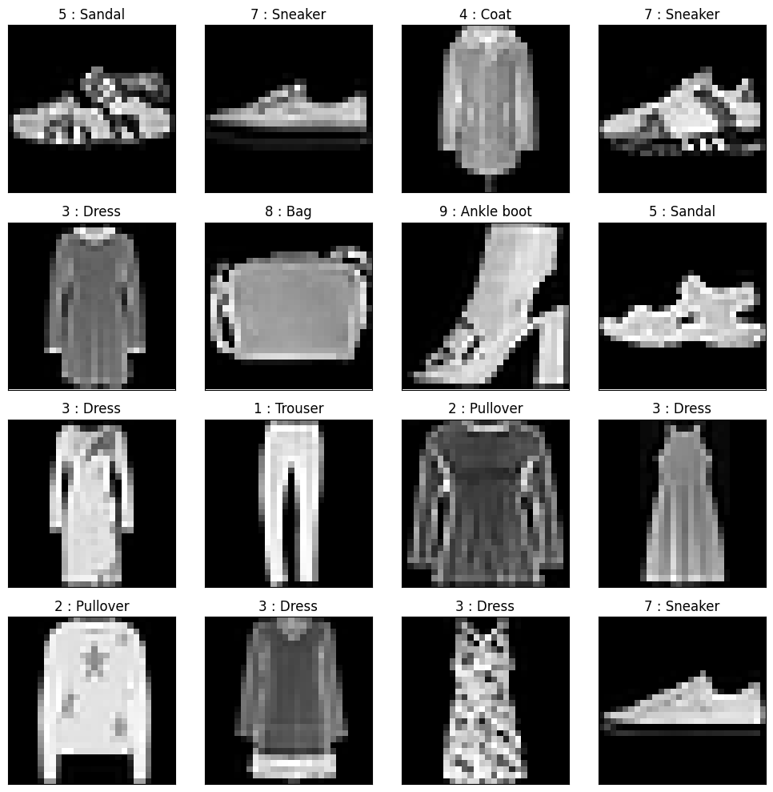
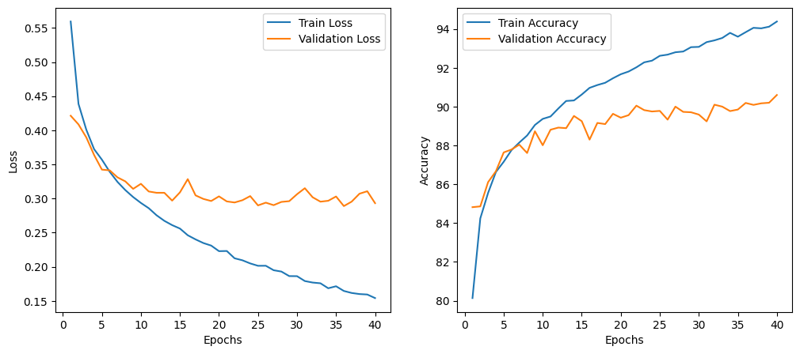
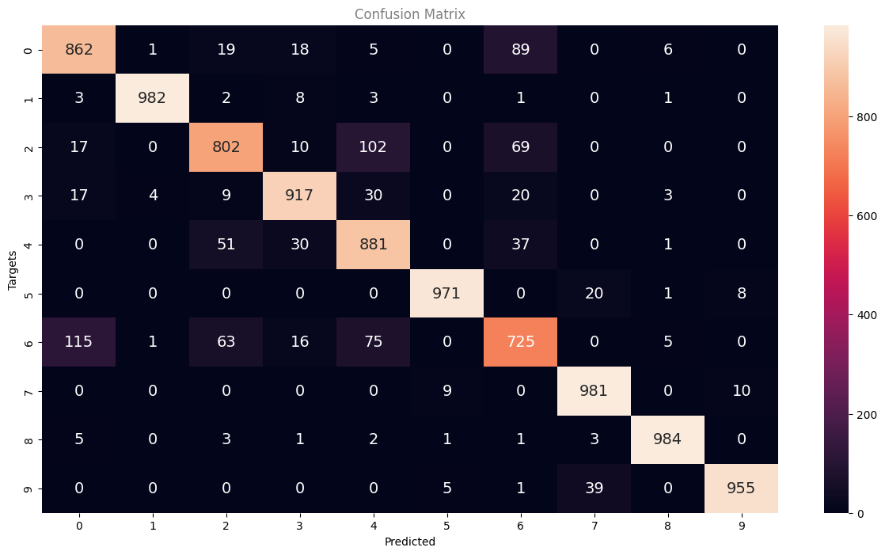

# 01 - Fashion-MNIST classification with an MLP

Classify 28x28 grayscale images of clothes into **10 classes** with a Multi-Layer Perceptron (MLP) written in **PyTorch**.

**Result: 90.60% accuracy** on the 10,000 test images (used as validation set).



## Dataset

- [Fashion-MNIST](https://github.com/zalandoresearch/fashion-mnist): 60,000 training images and 10,000 test images
- 10 classes: T-shirt/top, Trouser, Pullover, Dress, Coat, Sandal, Shirt, Sneaker, Bag, Ankle boot
- The data is downloaded automatically by `torchvision` (folder `F_MNIST_data/`, not stored in this repository)

## What I did

1. **Normalization from scratch**: I computed the mean (0.2860) and the standard deviation (0.3530) of all training pixels, then used them in `transforms.Normalize`. The validation set uses the same training values.
2. **Model**: an MLP with 4 hidden layers. Each block is `Linear -> BatchNorm1d -> ReLU`, with `Dropout(0.3)` after two blocks.
3. **Training loop written by hand**: forward pass, loss, backpropagation (`loss.backward()`), weight update (`optimizer.step()`), and a separate validation loop with `model.eval()` and `torch.no_grad()`.
4. **Analysis**: learning curves, class probabilities for each image, and a confusion matrix.

## Model

| Layer | Output shape | Parameters |
|---|---|---|
| Flatten | 784 | - |
| Linear + BatchNorm + ReLU + Dropout(0.3) | 512 | 402,944 |
| Linear + BatchNorm + ReLU | 256 | 131,840 |
| Linear + BatchNorm + ReLU + Dropout(0.3) | 128 | 33,152 |
| Linear + BatchNorm + ReLU | 64 | 8,384 |
| Linear + log_softmax | 10 | 650 |
| **Total** | | **576,970** |

## Training setup

| Setting | Value |
|---|---|
| Loss | Negative log-likelihood (`log_softmax` + `nll_loss` = cross-entropy) |
| Optimizer | Adam, learning rate 0.01 |
| Batch size | 64 |
| Epochs | 40 |
| Random seed | 42 |

## Results

| | Loss | Accuracy |
|---|---|---|
| Train (epoch 40) | 0.1542 | 94.38% |
| Validation (epoch 40) | 0.2932 | **90.60%** |





Class ids in the confusion matrix: 0 T-shirt/top, 1 Trouser, 2 Pullover, 3 Dress, 4 Coat, 5 Sandal, 6 Shirt, 7 Sneaker, 8 Bag, 9 Ankle boot.

## Error analysis

- **Best classes**: Bag (984 / 1000), Trouser (982), Sneaker (981).
- **Hardest class: Shirt** (725 / 1000). It is often predicted as T-shirt/top (115), Coat (75) or Pullover (63). These clothes have a very similar shape at 28x28 pixels.
- Pullover is also confused with Coat (102) and Shirt (69).
- Shoes (Sandal, Sneaker, Ankle boot) are only confused with each other, never with clothes.
- **Overfitting**: after about 10 epochs, the validation loss stays around 0.30, but the train loss still goes down (0.15 at the end). Dropout and BatchNorm reduce overfitting, but do not remove it.

## What I learned

- Why we normalize the input, and why we use only the **training** statistics.
- How BatchNorm and Dropout work, and why they behave differently in `train()` and `eval()` mode.
- The 5 steps of a training loop: `zero_grad`, forward, loss, `backward`, `step`.
- How to read learning curves and a confusion matrix to find the weak points of a model.
- The limit of an MLP for images: it flattens the image and loses the 2D position of the pixels.

## Next steps

- Train a small **CNN** on the same data and compare the results.
- Add early stopping or a learning-rate scheduler against overfitting.
- Use a separate validation set taken from the training data, and keep the test set only for the final result.

## How to run

```bash
pip install -r ../requirements.txt
jupyter notebook photo_classification.ipynb
```

Run the cells from top to bottom. A GPU is used if available, otherwise the CPU.
